  

  
  
  
  

 

## ⚡ About me

<table>
<tr>
<td width="55%" valign="top">

I'm a **Lead Software Engineer at Quinte Financial Technologies** with **7+ years** building enterprise software for **Banking & Financial Services**.

These days I work where **FinTech meets GenAI**: I design multi-agent systems with **Spring AI**, run local LLMs with **Ollama** and **vLLM**, and ship them as full-stack products on **Java 21**, **Spring Boot 3**, **Angular** and **Oracle**.

</td>
<td width="45%" valign="top">

🏦 &nbsp;**Domain**: ACH · Payments · Disputes 
🤖 &nbsp;**Focus**: Multi-agent AI, RAG, MCP 
🧩 &nbsp;**Stack**: Java · Spring · Angular · Oracle 
🌱 &nbsp;**Exploring**: Local LLM serving at scale 
💬 &nbsp;**Ask me about**: Spring AI in production

</td>
</tr>
</table>

 

  

 

## 🚀 Featured work

<table>
<tr>
<td width="50%" valign="top">

### 🏦 Enterprise AI Banking Assistant
AI-powered banking assistant with **multi-LLM support**. It switches between OpenAI, Ollama and vLLM without touching business logic.

</td>
<td width="50%" valign="top">

### 🔌 [RAG → MCP](https://github.com/thorthethunder/rag-to-mcp)
Tracing the path from **Retrieval-Augmented Generation** to the **Model Context Protocol**. Built during the Nasscom AI-Code Sarathi workshop.

</td>
</tr>
</table>

 

## 📊 GitHub at a glance

  

  
  

  
  

  <picture>
    <source media="(prefers-color-scheme: dark)" srcset="https://raw.githubusercontent.com/thorthethunder/thorthethunder/output/snake-dark.svg" />
    <source media="(prefers-color-scheme: light)" srcset="https://raw.githubusercontent.com/thorthethunder/thorthethunder/output/snake-light.svg" />
    
  </picture>

  

