

  

  &nbsp;&nbsp;
  &nbsp;&nbsp;
  

 

  

 

  

 

  
  

  
  

 


  

 


  

  
  

  
  

  <picture>
    <source media="(prefers-color-scheme: dark)" srcset="https://raw.githubusercontent.com/thorthethunder/thorthethunder/output/snake-dark.svg" />
    <source media="(prefers-color-scheme: light)" srcset="https://raw.githubusercontent.com/thorthethunder/thorthethunder/output/snake-light.svg" />
    
  </picture>

  

